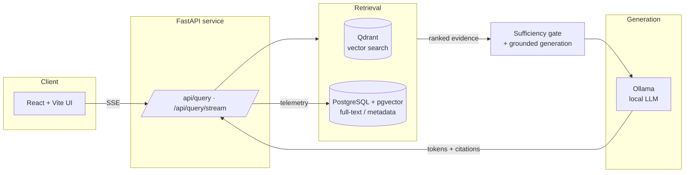
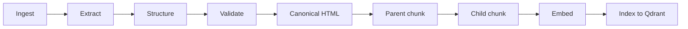

# theo-rag

**Evidence-first, on-prem Retrieval-Augmented Generation for theological (and other specialized) corpora.**

[](https://www.python.org/)
[](https://fastapi.tiangolo.com/)
[](https://react.dev/)
[](https://qdrant.tech/)
[](https://github.com/pgvector/pgvector)
[-000000?logo=ollama&logoColor=white)](https://ollama.com/)
[](LICENSE)

`theo-rag` is a production-grade RAG system that answers questions over a
curated document corpus **without hallucinating**. Every answer is grounded in
retrieved evidence, every claim carries a resolvable citation, and the system
**refuses to answer when the evidence is insufficient** rather than guessing.

It is designed to run **entirely on-premises** — local LLM (Ollama), local
embeddings (SentenceTransformers), local vector search (Qdrant), local
relational store (PostgreSQL + pgvector). No document ever leaves the machine.
The reference deployment runs on a single workstation with an **NVIDIA RTX PRO
6000** GPU serving a 70B-parameter model.

The reference corpora are two theological teaching archives (the *Clough* and
*Dean* corpora), but the pipeline is corpus-agnostic: point it at any collection
of long-form documents.

---

## Why evidence-first?

General-purpose LLMs are confidently wrong about specialized material. For
domains where correctness and attribution matter — legal, medical, financial,
scholarly, theological — a fluent-but-unsourced answer is worse than no answer.
`theo-rag` is built around four hard constraints:

| Constraint | How it's enforced |
| --- | --- |
| **Grounded** | Answers are generated *only* from retrieved corpus chunks. |
| **Cited** | Every sentence should resolve to a `[chunk:<id>]` citation backed by source metadata. |
| **Honest** | An evidence-**sufficiency gate** classifies each query `confident` / `narrow` / `refuse` before generation. |
| **Private** | Fully self-hosted; runs air-gapped on on-prem GPU hardware. |

---

## Highlights

- **Hybrid retrieval** — dense vector search (Qdrant) fused with lexical search
  (PostgreSQL full-text / BM25-style ranking), followed by a reranking and
  candidate-expansion stage.
- **Parent/child chunk graph** — small *child* chunks are the retrieval unit for
  precision; larger *parent* chunks are the citation/context unit for
  faithful, well-scoped answers.
- **Sufficiency-gated generation** — refuses or narrows scope when evidence is
  weak, instead of fabricating.
- **Citation guardrails** — post-generation coverage checks with optional
  citation retry / auto-mapping when the model under-cites.
- **Typed streaming protocol** — token-by-token SSE with a stable
  `status → citations → token → final` contract.
- **Reproducible evaluation harness** — a fixed 200-case benchmark with
  gold/silver tiers, deterministic CI checks, and baseline-vs-candidate
  regression gating.
- **First-class observability** — structured request logging plus relational
  telemetry for every query run, rerank, and piece of evidence used.
- **Flag-gated rollouts** — retrieval-quality improvements ship behind config
  flags that default to prior behavior, enabling safe staged enablement.

---

## Architecture



The system has two pipelines: an **offline content-build pipeline** that turns
raw documents into an indexed, retrievable corpus, and an **online query
pipeline** that serves grounded answers.

### Offline — content build



Each document advances through an explicit status lifecycle, and batch CLIs
discover work by status:

```
pending → extracted → structured → validated → chunked → child_chunked → embedded
```

### Online — query runtime

1. Frontend calls `/api/query/stream` (SSE) or `/api/query` (blocking JSON).
2. API validates the corpus and short-circuits small-talk.
3. A concurrency semaphore bounds simultaneous generations.
4. **Hybrid retrieval** returns ranked evidence + retrieval stats.
5. The **sufficiency gate** decides `confident` / `narrow` / `refuse`.
6. **Grounded generation** streams from the local LLM; output is
   citation-normalized, with optional citation retry/auto-map and a grounding
   decision.
7. Optional follow-up questions are generated conditionally.
8. Per-run telemetry is persisted (`rag_query_runs`, `rag_rerank`,
   `rag_evidence_used`).

See [`docs/ARCHITECTURE.md`](docs/ARCHITECTURE.md) for the deep dive.

---

## Tech stack

| Layer | Technology |
| --- | --- |
| API | FastAPI, Uvicorn, Pydantic v2 |
| Retrieval | Qdrant (vectors), PostgreSQL + pgvector (full-text + metadata) |
| Embeddings / rerank | SentenceTransformers |
| Generation | Ollama (e.g. `llama3.1:70b` primary, `llama3.1:8b` secondary) |
| Extraction | PyMuPDF, Docling |
| Data / ORM | SQLAlchemy 2.0, psycopg2 |
| Logging | structlog |
| Frontend | React, Vite, TypeScript, Zustand, Tailwind, Vitest |
| Infra | Docker Compose, Cloudflare Tunnel (on-prem exposure) |
| Runtime | On-prem, GPU-accelerated (reference: NVIDIA RTX PRO 6000) |

---

## Quickstart

### Prerequisites
- Docker + Docker Compose
- Python 3.12
- [Ollama](https://ollama.com/) running locally with a pulled model
- Node.js 18+ (for the frontend)

### 1 · Start infrastructure
```bash
docker compose up -d          # PostgreSQL (pgvector), Qdrant, Adminer
```

### 2 · Python environment
```bash
python -m venv .venv
source .venv/bin/activate
pip install -e .
```

### 3 · Configure environment
Copy the example env file and adjust as needed:
```bash
cp .env.public.example .env
```
Key variables: `DATABASE_URL`, `QDRANT_HOST`/`QDRANT_PORT`,
`QDRANT_EXPECTED_DIM`, `OLLAMA_HOST`, `OLLAMA_MODEL`,
`SECONDARY_OLLAMA_MODEL`, `API_ALLOWED_ORIGINS`.

### 4 · Apply database schema
```bash
psql "$DATABASE_URL" -f scripts/init.sql
for m in scripts/migrations/*.sql; do psql "$DATABASE_URL" -f "$m"; done
```

### 5 · Build a corpus
Place your source documents in `test/` (see [`test/README.md`](test/README.md)),
then run the pipeline:
```bash
python -m src.ingestion  test/ --batch --tag transcripts
python -m src.processing extract   --all --tag transcripts
python -m src.processing structure --all --tag transcripts
python -m src.processing validate  --all --tag transcripts
python -m src.chunking   parent    --all --tag transcripts
python -m src.chunking   child     --all --tag transcripts
python -m src.processing embed     --all --tag transcripts
python -m src.processing index clough
```

### 6 · Run the API
```bash
python -m uvicorn src.api.main:app --host 0.0.0.0 --port 8000
curl -s http://localhost:8000/api/health
```

### 7 · Run the frontend
```bash
cd frontend
npm ci
npm run dev            # set VITE_API_BASE if the API is on another origin
```

### Smoke test
```bash
curl -N http://localhost:8000/api/query/stream \
  -H "Content-Type: application/json" \
  -d '{"query":"What is faith-rest?","corpus":"clough","top_k":5}'
```

---

## API reference

| Method & path | Purpose |
| --- | --- |
| `POST /api/query` | Blocking grounded answer (JSON). |
| `POST /api/query/stream` | SSE stream: `status`, `citations`, `token`, `final`. |
| `GET /api/health` | Liveness. |
| `GET /api/collections` | Available corpora / Qdrant collections. |
| `GET /api/models` · `POST /api/models/pull` · `POST /api/models/keepalive` | Model management. |
| `POST /api/enrich_citations` | Resolve citation metadata for a set of chunks. |
| `GET /api/stats` | Corpus + Qdrant point counts. |
| `GET /api/evidence/{evidence_id}` | Inspect a single retrieved chunk. |

**`POST /api/query` body:** `query` (string), `corpus` (`"clough" | "dean"`),
`top_k` (1–20, default 5), optional `model`, `retrieval_mode` (`"fast" | "deep"`),
and `history`. Pass an `X-Session-Id` header to correlate telemetry.

---

## Evaluation

Answer quality is measured against a **fixed, versioned benchmark** rather than
vibes:

- **200 cases** — 100 `clough` + 100 `dean`; 90 `gold` + 110 `silver`.
- Each case declares expected mode, refusal expectations, minimum citations,
  hierarchy policy, and gold/silver acceptance rules.
- Deterministic CI checks validate the dataset and the streaming contract.
- A gate comparator scores **baseline vs candidate** and can hard-fail on
  regressions.

```bash
# Run the benchmark against a live API
python scripts/eval_suite.py \
  --api-base http://localhost:8000 \
  --input eval/benchmark/v1_cases.jsonl \
  --mode both

# Compare a candidate run against a baseline and gate on regressions
python scripts/eval_compare.py \
  --baseline baseline_summary.json \
  --candidate candidate_summary.json \
  --output gate_verdict.json \
  --fail-on-hard
```

Per-run artifacts (`summary.json`, `per_case.jsonl`, `metrics_by_corpus.json`,
`metrics_by_class.json`, `telemetry_join.json`) land under
`eval/reports/runs/<run_id>/`. See [`eval/README.md`](eval/README.md).

---

## Observability

- **Structured logging** with per-request context (`src/observability`).
- **Relational telemetry** written via ORM helpers (`src/telemetry`) into
  `rag_query_runs`, `rag_rerank`, and `rag_evidence_used`.
- **`GET /api/stats`** exposes Qdrant point counts overall and per corpus.
- **Evidence inspector** (`GET /api/evidence/{id}`) resolves chunk detail and
  canonical source paths for debugging retrieval.

---

## Project layout

```
src/
├── ingestion/      # ingest raw sources + parse metadata
├── processing/     # extraction, structure detection, validation, canonical HTML
├── chunking/       # parent (citation) + child (retrieval) chunking
├── embedding/      # embedding generation + Qdrant indexing
├── retrieval/      # hybrid retrieval, fusion, rerank, dedup
├── generation/     # sufficiency gate + grounded generation + streaming
├── api/            # FastAPI app, routes, request/response models
├── corpus/         # corpus registry (typed corpus IDs)
├── db/             # SQLAlchemy models, session, operations
├── telemetry/      # telemetry writers
├── observability/  # logging + request middleware
└── utils/          # config + logging setup
frontend/           # React + Vite + TypeScript chat UI
scripts/            # init.sql, migrations, eval + SQL utilities
eval/               # benchmark dataset + evaluation harness
docs/               # architecture + deployment docs
```

---

## On-prem & data sovereignty

`theo-rag` targets environments where documents are **sensitive or
proprietary and cannot go to a third-party cloud**. Every model runs locally:
generation via Ollama, embeddings via SentenceTransformers, vector search via
Qdrant, and metadata in PostgreSQL. The reference deployment publishes the UI
and API to the internet through a **Cloudflare Tunnel** (no inbound ports
opened) while all inference and data stay on the local GPU workstation — see
[`docs/cloudflare_tunnel_setup.md`](docs/cloudflare_tunnel_setup.md).

---

## License

Released under the [MIT License](LICENSE).

Built by **Tanishq Rathore** — [tanishqrathore.com](https://tanishqrathore.com)

> The original teaching transcripts used to build the production corpora are
> **not distributed** with this repository.
