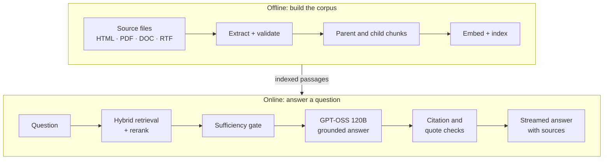

# theo-rag

**Evidence-first question answering over specialised teaching archives, running
on one on-premises GPU workstation.**

[](https://github.com/thetanishqrathore/theo-rag/actions/workflows/ci.yml)
[](https://www.python.org/)
[](https://fastapi.tiangolo.com/)
[](https://react.dev/)
[](https://qdrant.tech/)
[](https://www.postgresql.org/)
[](LICENSE)

Ask a question about a teacher's body of work and `theo-rag`:

1. finds the exact passages that address it,
2. answers **only from those passages**, citing each claim as a clickable
   `[chunk:<id>]` source,
3. says plainly what the sources do not cover, and refuses when nothing
   relevant exists.

The reference deployment serves two theological archives: Charles A. Clough's
transcripts and course notes, and Pastor Dean's Bible-book lessons and
topical studies. That's 2,502 source documents, indexed as 95,382 searchable
passages. The pipeline itself works for any collection of long-form documents.

---

## Contents

- [What makes it evidence-first](#what-makes-it-evidence-first)
- [How it works](#how-it-works)
- [Measured quality](#measured-quality)
- [Quickstart](#quickstart)
- [API](#api)
- [Documentation](#documentation)
- [Project layout](#project-layout)
- [Status and roadmap](#status-and-roadmap)

---

## What makes it evidence-first

| Property | How it is enforced |
| --- | --- |
| **Grounded** | The model sees only retrieved passages. It must not add names, terms or details that the sources lack. |
| **Cited** | Answers cite passages inline. Every citation resolves to a stored passage with its lesson, series and source file. |
| **Honest about gaps** | A sufficiency gate decides `confident`, `narrow` or `refuse` before generation. Partly covered questions get the covered part plus an explicit note of what is missing. |
| **Faithful quotations** | Quoted text is checked against the sources after generation, and quotation marks are removed from anything not found word for word. |
| **Measured** | A fixed 200-case benchmark with hard and soft gates runs before every behaviour change ([`docs/EVALUATION.md`](docs/EVALUATION.md)). |
| **Private** | Documents, embeddings and all inference stay on the workstation. Public access goes through an outbound Cloudflare Tunnel; no inbound ports are opened. |

What this does **not** claim: `grounded=true` means the answer carries valid
citations to the evidence it was given. It is not an automatic proof that every
sentence follows from the cited passage. Expert review remains the standard for
theological accuracy.

---

## How it works



**Offline.** Every source file is inventoried in a manifest with an include or
exclude reason. The build extracts text, validates it, splits it into
**parent chunks** (300–600 words, the unit that is cited and shown to the model)
and **child chunks** (about 150 words, the unit that is searched), embeds the
children and indexes them. The build is resumable, records its provenance and
ends with an exact ID-parity check between PostgreSQL and Qdrant.

**Online.** A question is answered in eight steps:

1. The LLM rewrites it for **dense search** over child-chunk embeddings.
2. A **keyword search** over the user's own words, weighted by how rare each
   term is in the corpus, catches names and technical terms that dense search
   misses.
3. A **cross-encoder reranks** the combined candidates.
4. The top passages expand to their parents.
5. The **sufficiency gate** chooses confident, narrow or refuse.
6. **GPT-OSS 120B** writes the answer with inline citations.
7. **Post-processing** normalises citations and verifies quotations.
8. The answer streams to the UI over SSE: `status` → `citations` → `token`* →
   `final`. Every run is recorded in telemetry tables.

Details: [`docs/ARCHITECTURE.md`](docs/ARCHITECTURE.md).

| Layer | Technology |
| --- | --- |
| Generation | Ollama · `gpt-oss:120b` (MXFP4, 32k context) |
| Embeddings · rerank | `BAAI/bge-m3` · `BAAI/bge-reranker-large` (SentenceTransformers) |
| Search | Qdrant 1.7 (vectors) · PostgreSQL 16 full-text (keywords) |
| API | FastAPI · Uvicorn · Pydantic v2 · SQLAlchemy 2 · structlog |
| Extraction | PyMuPDF · Docling · Marker 1.x · LibreOffice |
| Frontend | React · Vite · TypeScript · Zustand · Tailwind · Vitest |
| Operations | Docker Compose · systemd user units · Cloudflare Tunnel |

---

## Measured quality

200-case benchmark (100 per corpus), each case run against both endpoints. Full
definitions and method: [`docs/EVALUATION.md`](docs/EVALUATION.md).

| Metric | Phase 1 baseline | Current `main` |
| --- | ---: | ---: |
| Endpoint errors | 0 / 400 | 0 / 400 |
| Citation IDs that resolve | 100% | 100% |
| Refusal F1 (refuses exactly when it should) | 0.98 | **1.00** |
| Anchor recall (expected key terms found in answer or evidence) | 0.61 | **0.63** |
| Sentences carrying a citation | 0.46 | **0.50** |
| Answer-mode accuracy | 0.70 | 0.68 |
| Latency avg / p95 | 11.2 / 17.1 s | 11.5 / 17.7 s |

An expert review of 20 Phase 1 answers found correct teacher attribution in all
138 cited sentences. It also found weak quotation fidelity (44% verbatim), which
the quotation check now addresses. What changed between the two columns:
[`CHANGELOG.md`](CHANGELOG.md).

---

## Quickstart

Requirements:
- Linux with an NVIDIA GPU (80–90 GB of VRAM to serve GPT-OSS 120B with
  the embedder and reranker, about 95 GB during a full build)
- Docker with Compose
- Python 3.12 with [uv](https://docs.astral.sh/uv/)
- Node.js 22
- [Ollama](https://ollama.com/)
- LibreOffice and Marker 1.x, for DOC/RTF and PDF sources

Full setup, service management, backups and rollback:
[`docs/OPERATIONS.md`](docs/OPERATIONS.md).

```bash
# 1. Environment and infrastructure
uv sync --locked --extra dev
cp .env.public.example .env                 # set data paths and tool commands
docker compose up -d                        # PostgreSQL + Qdrant on 127.0.0.1
.venv/bin/python scripts/migrate.py && .venv/bin/python scripts/migrate.py --check
ollama pull gpt-oss:120b

# 2. Build the corpus from your documents (resumable)
.venv/bin/python scripts/source_manifest.py --root /path/to/corpus \
  --output ~/theo-rag-data/source_manifest.json
.venv/bin/python scripts/build_corpus.py --manifest ~/theo-rag-data/source_manifest.json \
  --report-dir ~/theo-rag-data/build_reports

# 3. Serve the API and the web UI on :8000
npm --prefix frontend ci && npm --prefix frontend run build
.venv/bin/uvicorn src.api.main:app --host 0.0.0.0 --port 8000 --workers 1
```

On the reference machine the whole system (containers, API, tunnel) is
controlled with one script once the service is installed:

```bash
./theorag.sh status        # also: start [--local] | stop | restart | logs | boot on|off
```

Smoke test:

```bash
curl -s localhost:8000/api/health
curl -s localhost:8000/api/query -H 'Content-Type: application/json' \
  -d '{"query":"What is the faith-rest drill?","corpus":"clough","top_k":5}'
```

The original teaching documents are **not distributed** with this repository.
Supply your own to run the pipeline end to end.

---

## API

| Method and path | Purpose |
| --- | --- |
| `POST /api/query` | Grounded answer as JSON |
| `POST /api/query/stream` | The same answer as Server-Sent Events: `status`, `citations`, `token`, `final` |
| `GET /api/health` | PostgreSQL, Qdrant and Ollama status |
| `GET /api/evidence/{id}` | One passage with its source metadata |
| `GET /api/stats` | Indexed passages per corpus |
| `GET /api/collections` · `GET /api/models` | Available corpora and allowed models |

Request body: `query`, `corpus` (`"clough"` or `"dean"`), `top_k` (1–20,
default 5), optional `retrieval_mode` (`"fast"` or `"deep"`) and `history`. Send
`X-Session-Id` to correlate telemetry.

The JSON response carries:
- `answer`
- `citations` (with lesson, series and source metadata)
- `grounded`
- `refusal`
- `follow_up_questions`
- timings

The stream's `final` event also carries `answer_mode` (`confident`, `narrow` or
`refuse`).

---

## Documentation

| Document | What it covers |
| --- | --- |
| [`docs/ARCHITECTURE.md`](docs/ARCHITECTURE.md) | Data model, build pipeline, retrieval, keyword search, sufficiency gate, prompt rules, quote check, streaming, flags |
| [`docs/EVALUATION.md`](docs/EVALUATION.md) | The benchmark, every metric's exact definition, running and comparing runs, human review, results |
| [`docs/OPERATIONS.md`](docs/OPERATIONS.md) | Setup, corpus build, services, health checks, backup and restore, rollback |
| [`docs/RESTORATION_NOTES.md`](docs/RESTORATION_NOTES.md) | How the Phase 1 baseline was restored: defects fixed, corpus decisions, measured results |
| [`docs/cloudflare_tunnel_setup.md`](docs/cloudflare_tunnel_setup.md) | Publishing the UI without opening inbound ports |
| [`CHANGELOG.md`](CHANGELOG.md) | What changed, when, and what it did to the numbers |
| [`frontend/README.md`](frontend/README.md) | The web UI |

---

## Project layout

```
src/
├── ingestion/      register sources, parse metadata (series, lessons, dates)
├── processing/     extract, detect structure, validate, canonical HTML, embed, index
├── chunking/       parent (cited) and child (searched) chunks
├── retrieval/      dense + keyword search, rerank, diversity, hierarchy boost
├── generation/     sufficiency gate, prompt, grounded generation, citation and quote checks
├── api/            FastAPI app and routes
├── corpus/         corpus registry
├── db/             SQLAlchemy models and sessions
├── telemetry/      per-query telemetry writers
├── observability/  structured logging, request middleware
└── utils/          configuration (all flags) and logging
frontend/           React + Vite chat UI
scripts/            build, migrations, evaluation, operations
eval/               benchmark cases, schema and labelling guide
tests/              backend tests (pytest)
docs/               architecture, evaluation, operations, restoration record
```

---

## Status and roadmap

- **Phase 1, done (tag `phase1-baseline`).** The system was restored from its
  public release:
  - full corpus built with exact index parity;
  - reproducible setup;
  - self-verifying backups;
  - boot-time services;
  - a measured benchmark baseline.
- **Phase 2, in progress.** Three changes are on `main` and measured
  ([`CHANGELOG.md`](CHANGELOG.md)):
  - keyword search rebuilt;
  - partial answers instead of flat refusals;
  - quotation check.

  Next:
  - **Source text cleanup:** fix lessons indexed with wrong character encoding
    or hidden word-processor text, then rebuild them.
  - **Rerank against the user's own question** as well as the LLM rewrite.
  - **Claim support check:** test each cited sentence against its passage with
    the reranker.
  - **Speaker attribution** for guest material inside a teacher's archive.

Built by **Tanishq Rathore** · [tanishqrathore.com](https://tanishqrathore.com) ·
released under the [MIT License](LICENSE).
