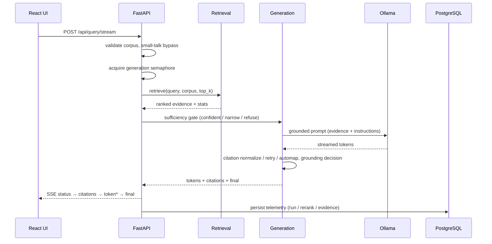

# Architecture

A deep dive into how `theo-rag` turns a pile of long-form documents into a
grounded, citable question-answering system that runs entirely on-premises.

- [Design goals](#design-goals)
- [Data model](#data-model)
- [Offline pipeline — content build](#offline-pipeline--content-build)
- [Parent/child chunking](#parentchild-chunking)
- [Online pipeline — query runtime](#online-pipeline--query-runtime)
- [Hybrid retrieval](#hybrid-retrieval)
- [Grounded generation](#grounded-generation)
- [Streaming protocol](#streaming-protocol)
- [Telemetry & observability](#telemetry--observability)
- [Configuration & feature flags](#configuration--feature-flags)
- [Deployment topology](#deployment-topology)
- [Design decisions & trade-offs](#design-decisions--trade-offs)

---

## Design goals

The system is built around one thesis: **for specialized corpora, a fluent
answer with no evidence is a liability.** Four properties are treated as
non-negotiable:

1. **Grounded** — the model generates only from retrieved corpus evidence.
2. **Cited** — claims resolve to `[chunk:<id>]` references backed by source metadata.
3. **Honest** — the system refuses or narrows when evidence is insufficient.
4. **Private** — everything runs locally; no data leaves the host.

Everything below is downstream of those four goals.

---

## Data model

State lives in PostgreSQL, organized into layers:

| Layer | Tables (representative) | Role |
| --- | --- | --- |
| Infrastructure | `corpus`, `file_tags`, `source_files` | What was ingested and from where. |
| Metadata graph | `series`, `parts`, `chapters`, `lessons`, per-corpus metadata | The logical structure of the corpus. |
| Content | `paragraphs`, node/table stores | Normalized extracted text. |
| Retrieval | `parent_chunks`, `child_chunks`, `child_chunk_audit` | Units used at query time. |
| Telemetry | `rag_query_runs`, `rag_rerank`, `rag_evidence_used` | What happened on each query. |

Vector embeddings live in **Qdrant** (one collection per corpus,
`<corpus>_chunks`); PostgreSQL holds the source-of-truth text, structure, and
telemetry. The relational schema is created by `scripts/init.sql` and evolved by
ordered, idempotent migrations under `scripts/migrations/`.

---

## Offline pipeline — content build

Raw documents become a retrievable corpus through explicit, resumable stages.
Each `lesson` (unit of content) carries a **status**, and batch CLIs discover
work by querying for the next status — so the pipeline is restartable and
inspectable at every step.

```
pending → extracted → structured → validated → chunked → child_chunked → embedded
```

| Stage | Command | What it does |
| --- | --- | --- |
| Ingest | `python -m src.ingestion` | Register source files, build the lesson/metadata graph. |
| Extract | `src.processing extract` | Extract text into normalized paragraph rows. |
| Structure | `src.processing structure` | Preserve node hierarchy where present; detect boundaries otherwise. |
| Validate | `src.processing validate` | Profile-aware quality checks with a score/reason report. |
| Canonical | `src.processing canonical` | Render canonical HTML for inspection/debugging. |
| Parent chunk | `src.chunking parent` | Build citation-scoped parent chunks. |
| Child chunk | `src.chunking child` | Build retrieval-scoped child chunks. |
| Embed | `src.processing embed` | Generate child-chunk embeddings + audit rows. |
| Index | `src.processing index <corpus>` | Upsert vectors into Qdrant. |

Validation is **profile-aware**: thresholds come from configuration
(`AppConfig.validation_profile_thresholds()`), and can be overridden per profile
via a JSON map (`VALIDATION_PROFILE_THRESHOLD_OVERRIDES`) without code changes —
different document types (clean course notes vs. rough transcripts) get
different quality bars.

---

## Parent/child chunking

Retrieval and citation have opposite ideal chunk sizes, so the system keeps two
chunk layers:

- **Child chunks** are small and are the **retrieval/index unit**. Small chunks
  make dense retrieval precise — the embedding of a focused passage is a better
  match for a focused query than the embedding of a whole section.
- **Parent chunks** are larger and are the **citation/context unit**. Once child
  chunks are retrieved, their parents provide enough surrounding context for the
  model to write a faithful, well-scoped answer and for a citation to point at a
  meaningful span.

Child chunking respects semantic block boundaries before falling back to
token-window splitting, so chunks don't cut mid-thought.

---

## Online pipeline — query runtime



Notable control-flow details:

- **Small-talk bypass** — greetings and meta questions skip retrieval entirely.
- **Concurrency semaphore** — generation is bounded so a single GPU serving a
  large model degrades gracefully under load (returns `503 busy` rather than
  thrashing). Bound via `RAG_GENERATION_MAX_CONCURRENCY`.
- **Retrieval modes** — `fast` and `deep` trade latency for recall/depth, with
  per-corpus defaults.

---

## Hybrid retrieval

Retrieval combines complementary signals and then refines the candidate set:

1. **Dense vector search** (Qdrant) — semantic similarity over child-chunk
   embeddings.
2. **Lexical search** (PostgreSQL full-text, BM25-style ranking) — exact-term
   and rare-term recall that dense retrieval misses. An optional **OR-fallback**
   widens the `tsquery` when a strict match returns too few hits.
3. **Fusion** — dense and lexical result lists are merged. **Reciprocal Rank
   Fusion (RRF)** combines them by rank rather than raw score, avoiding
   score-scale mismatch between the two systems.
4. **Reranking + expansion** — candidates are reranked, with stable tie-breaking
   so equal-scored results have a deterministic order (important for
   reproducible evals).
5. **Near-duplicate dedup** — highly overlapping child chunks (Jaccard over token
   sets) are collapsed so the context window isn't spent on repeats.
6. **Parent diversity** — results are diversified across parent chunks so the
   evidence set covers breadth, not one section repeated.
7. **Hierarchy-aware boost** *(optional)* — when structural metadata
   (`node_path` / `section_path`) exists, retrieval can apply a **positive-only**
   rerank bonus. When it's missing (common in flat transcripts) there is **no
   penalty** — ranking stays neutral.

Retrieval caches use a generic LRU implementation to avoid recomputing hot
queries. Many of these refinements (RRF, stable tie-breaks, OR-fallback, dedup,
hierarchy boost) are **flag-gated** — see [feature flags](#configuration--feature-flags).

---

## Grounded generation

Before any tokens are generated, an **evidence-sufficiency gate** classifies the
query given the retrieved evidence:

| Mode | Meaning |
| --- | --- |
| `confident` | Strong evidence — answer normally. |
| `narrow` | Partial evidence — answer, but scope down / hedge. |
| `refuse` | Insufficient evidence — decline rather than fabricate. |

When generation proceeds, the model is prompted to cite chunks inline as
`[chunk:<uuid>]`. Output then passes through post-processing:

- **Citation normalization / extraction** — parse and canonicalize citation refs.
- **Citation retry / auto-map** — if the model under-cites or emits refs that
  don't resolve, an optional retry or automatic mapping step repairs coverage.
- **Citation coverage guardrail** — measures the fraction of sentences that are
  cited against `RAG_CITATION_GUARDRAIL_MIN_COVERAGE`. In log-only mode it just
  records the metric; when enforcement is on, a low-coverage answer sets
  `citation_guardrail_triggered` for downstream handling.
- **Grounding decision** — a final determination of whether the answer is
  adequately grounded, surfaced in the response.
- **Conditional follow-ups** — related follow-up questions are generated only
  when appropriate, off the critical path (so they never block the `final` event).

---

## Streaming protocol

`/api/query/stream` is Server-Sent Events with a **stable, typed contract** —
clients can rely on these payload types across releases:

| Event `type` | Payload |
| --- | --- |
| `status` | Progress/among-phase updates. |
| `citations` | The evidence set backing the answer. |
| `token` | An incremental text fragment. |
| `final` | Terminal event with the complete answer + metadata. |
| `error` | Error surface. |

The frontend (`frontend/src/lib/api.ts`) parses this stream; the eval harness
(`scripts/eval_suite.py`) validates it. Keeping the contract stable is an
explicit compatibility guarantee, not an accident.

---

## Telemetry & observability

Every query writes structured telemetry through ORM models (not raw SQL), which
keeps writes type-checked and schema-aligned:

- **`rag_query_runs`** — one row per query: mode, outcome (`completed` /
  `aborted`), timings, citation stats.
- **`rag_rerank`** — rerank inputs/outputs for diagnosing ranking.
- **`rag_evidence_used`** — which chunks actually backed the answer.

Alongside telemetry, request middleware emits lifecycle events, and
retrieval/generation phases emit span/event logs via `structlog`. `GET
/api/stats` exposes Qdrant point counts (overall and per corpus), and `GET
/api/evidence/{id}` resolves a chunk's detail and canonical source path — so a
surprising answer can be traced back to the exact evidence that produced it.

---

## Configuration & feature flags

Configuration is centralized in `src/utils/config.py` (`AppConfig`,
`pydantic-settings`), exposing grouped views (`database`, `vector_store`,
`sufficiency`) over flat environment keys.

Retrieval-quality improvements are introduced **behind flags that default to
prior behavior**, so upgrading the code changes nothing until a flag is flipped.
Representative flags:

```bash
RAG_RRF_FUSION_ENABLED=false            # reciprocal rank fusion of dense+lexical
RAG_STABLE_TIEBREAK=false               # deterministic ordering of equal scores
RAG_PARENT_DIVERSITY_STABLE=false       # stable parent-chunk diversification
RAG_BM25_OR_FALLBACK_ENABLED=false      # widen tsquery when hits are sparse
RAG_CHILD_DEDUP_ENABLED=false           # Jaccard near-duplicate collapse
RAG_HIERARCHY_BOOST_ENABLED=false       # positive-only structural rerank bonus
RAG_CITATION_GUARDRAIL_ENABLED=false    # enforce citation coverage
```

This enables a disciplined rollout: deploy with defaults, reindex if a flag
needs new payload (e.g. `section_path`), enable in staging, watch
error/refusal/coverage/latency deltas, then enable in production.

---

## Deployment topology

The reference deployment is a single on-prem GPU workstation:

- **Ollama** serves the generation model on the local GPU (reference hardware:
  NVIDIA RTX PRO 6000, large enough to hold a 70B model resident).
- **Qdrant** and **PostgreSQL + pgvector** run as local containers
  (`docker-compose.yml`).
- The **FastAPI** backend and **Vite**-built frontend are served locally.
- A **Cloudflare Tunnel** publishes the UI and API to the public internet
  **without opening any inbound ports** — outbound-only, with hostnames mapped to
  local services. See `docs/cloudflare_tunnel_setup.md`.

The result: users reach the app over the internet, but every document, every
embedding, and every token of inference stays on the local machine.

---

## Design decisions & trade-offs

- **Refuse over hallucinate.** The sufficiency gate deliberately sacrifices
  coverage for trustworthiness. For specialized corpora that's the right trade;
  a confident wrong answer is the worst outcome.
- **Two chunk layers instead of one.** More build complexity and storage, but it
  decouples retrieval precision from citation/context quality — you can't get
  both from a single chunk size.
- **Fuse by rank (RRF), not score.** Dense cosine similarity and lexical rank
  aren't on the same scale; rank fusion sidesteps brittle score normalization.
- **Positive-only hierarchy boost.** Structural metadata helps when present but
  is inconsistent across document types, so it can only ever *help* a result —
  never penalize flat content that legitimately lacks structure.
- **Flag-gated everything.** Every quality change ships dormant. This makes
  regressions attributable and rollouts reversible, at the cost of more config
  surface.
- **ORM telemetry over raw SQL.** Slightly more indirection, but writes stay
  aligned with the schema and are far less error-prone as the model evolves.
- **On-prem by design, not by port.** Data sovereignty is a product requirement,
  so exposure is solved with an outbound tunnel rather than inbound firewall
  holes — the security posture stays "nothing listens publicly."
