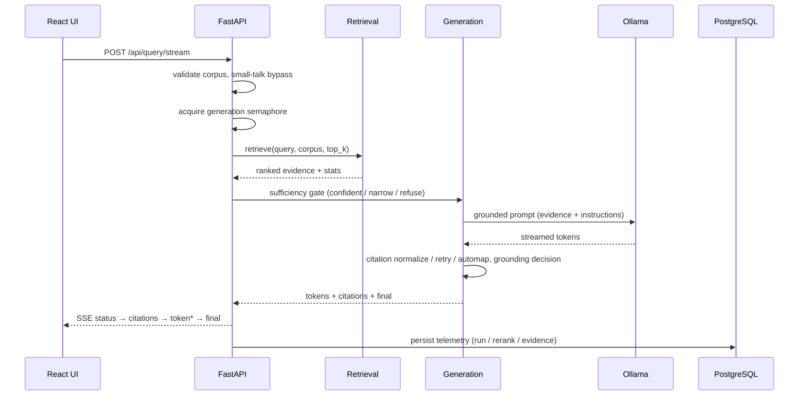
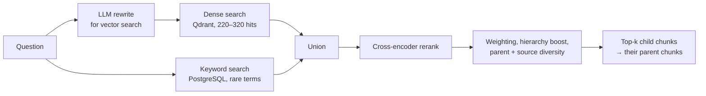

# Architecture

A deep dive into how `theo-rag` turns a pile of long-form documents into a
grounded, citable question-answering system that runs on a single on-premises
GPU workstation.

- [Design goals](#design-goals)
- [Models](#models)
- [Data model](#data-model)
- [Offline pipeline — content build](#offline-pipeline--content-build)
- [Parent/child chunking](#parentchild-chunking)
- [Online pipeline — query runtime](#online-pipeline--query-runtime)
- [Hybrid retrieval](#hybrid-retrieval)
- [Grounded generation](#grounded-generation)
- [Streaming protocol](#streaming-protocol)
- [Telemetry & observability](#telemetry--observability)
- [Configuration & feature flags](#configuration--feature-flags)
- [Deployment topology](#deployment-topology)
- [Design decisions & trade-offs](#design-decisions--trade-offs)

---

## Design goals

The system is built around one thesis: **for specialized corpora, a fluent
answer with no evidence is a liability.** Four properties are treated as
non-negotiable:

1. **Grounded** — the model generates only from retrieved corpus evidence.
2. **Cited** — claims resolve to `[chunk:<id>]` references backed by source metadata.
3. **Honest** — the system refuses or narrows when evidence is insufficient.
4. **Private** — documents, embeddings and inference stay on the host. Only
   questions and answers cross the network, through an outbound tunnel.

Everything below is downstream of those four goals.

---

## Models

All models run locally on one GPU (reference: NVIDIA RTX PRO 6000 Blackwell, 96 GB).

| Role | Model | Notes |
| --- | --- | --- |
| Generation, query rewrite | `gpt-oss:120b` via Ollama | MXFP4, about 65 GB on disk; 32k context; temperature 0.1 |
| Embeddings | `BAAI/bge-m3` | 1,024-dimensional dense vectors for child chunks and queries |
| Reranking | `BAAI/bge-reranker-large` | cross-encoder that scores every (query, passage) pair |

GPT-OSS is a reasoning model. Its reasoning tokens are streamed only as
`status` heartbeats and never reach answers, citations or telemetry.

---

## Data model

State lives in PostgreSQL, organized into layers:

| Layer | Tables (representative) | Role |
| --- | --- | --- |
| Infrastructure | `corpus`, `file_tags`, `source_files` | What was ingested and from where. |
| Metadata graph | `series`, `parts`, `chapters`, `lessons`, per-corpus metadata | The logical structure of the corpus. |
| Content | `paragraphs`, node/table stores | Normalized extracted text. |
| Retrieval | `parent_chunks`, `child_chunks`, `child_chunk_audit` | Units used at query time. |
| Telemetry | `rag_query_runs`, `rag_rerank`, `rag_evidence_used` | What happened on each query. |

Vector embeddings live in **Qdrant** (one collection per corpus,
`<corpus>_chunks`); PostgreSQL holds the source-of-truth text, structure, and
telemetry. The relational schema is created by `scripts/init.sql` and evolved by
ordered, idempotent migrations under `scripts/migrations/`.

---

## Offline pipeline — content build

Raw documents become a retrievable corpus through explicit, resumable stages.
Each `lesson` (unit of content) carries a **status**, and batch CLIs discover
work by querying for the next status — so the pipeline is restartable and
inspectable at every step.

```
pending → extracted → structured → validated → chunked → child_chunked → embedded
```

| Stage | Command | What it does |
| --- | --- | --- |
| Ingest | `python -m src.ingestion` | Register source files, build the lesson/metadata graph. |
| Extract | `src.processing extract` | Extract text into normalized paragraph rows. |
| Structure | `src.processing structure` | Preserve node hierarchy where present; detect boundaries otherwise. |
| Validate | `src.processing validate` | Profile-aware quality checks with a score/reason report. |
| Canonical | `src.processing canonical` | Render canonical HTML for inspection/debugging. |
| Parent chunk | `src.chunking parent` | Build citation-scoped parent chunks. |
| Child chunk | `src.chunking child` | Build retrieval-scoped child chunks. |
| Embed | `src.processing embed` | Generate child-chunk embeddings + audit rows. |
| Index | `src.processing index <corpus>` | Upsert vectors into Qdrant. |

Validation is **profile-aware**: thresholds come from configuration
(`AppConfig.validation_profile_thresholds()`), and can be overridden per profile
via a JSON map (`VALIDATION_PROFILE_THRESHOLD_OVERRIDES`) without code changes —
different document types (clean course notes vs. rough transcripts) get
different quality bars.

---

## Parent/child chunking

Retrieval and citation have opposite ideal chunk sizes, so the system keeps two
chunk layers:

- **Child chunks** are small and are the **retrieval/index unit**. Small chunks
  make dense retrieval precise — the embedding of a focused passage is a better
  match for a focused query than the embedding of a whole section.
- **Parent chunks** are larger and are the **citation/context unit**. Once child
  chunks are retrieved, their parents provide enough surrounding context for the
  model to write a faithful, well-scoped answer and for a citation to point at a
  meaningful span.

Child chunking respects semantic block boundaries before falling back to
token-window splitting, so chunks don't cut mid-thought.

---

## Online pipeline — query runtime



Notable control-flow details:

- **Small-talk bypass** — greetings and meta questions skip retrieval entirely.
- **Concurrency semaphore** — generation is bounded so a single GPU serving a
  large model degrades gracefully under load (returns `503 busy` rather than
  thrashing). Bound via `RAG_GENERATION_MAX_CONCURRENCY`.
- **Retrieval modes** — `fast` and `deep` trade latency for recall/depth, with
  per-corpus defaults.

---

## Hybrid retrieval

Retrieval combines two complementary searches and then refines the candidate
set (`src/retrieval/retrieve.py`, `retrieve_context_with_stats`):



1. **Query rewrite.** The LLM rewrites a vague or conversational question (and
   its history) into a precise retrieval query for dense search and reranking.
2. **Dense vector search** (Qdrant). Semantic similarity over child-chunk
   embeddings: 220 candidates in `fast` mode and 320 in `deep` mode.
3. **Keyword search** (PostgreSQL full-text). This recovers exact and rare terms
   (names, Greek words, technical vocabulary) that dense search misses. See below.
4. **Union.** Candidates from both searches are merged by child-chunk ID.
   Reciprocal Rank Fusion is available behind a flag.
5. **Reranking.** A cross-encoder scores every candidate against the query.
   This is the most expensive step and the strongest relevance signal.
6. **Refinement.** This step has several parts:
   - **Weighting** favours dense, definition-like passages.
   - **Hierarchy boost** gives a positive-only bonus when structural metadata
     (`node_path` / `section_path`) exists. Flat transcripts get no penalty.
   - **Parent diversity** stops one section from filling the context.
   - **Source diversity** spreads the evidence across lessons.
   - *Optional:* near-duplicate collapse (Jaccard over token sets).
7. **Context.** The top-k child chunks are expanded to their parent chunks. The
   parents become the prompt's evidence and the citation targets.

### Keyword search

The keyword query is built from the user's **original question**, not from the
LLM rewrite. When the question has a conversation history it uses the rewrite,
which resolves pronouns.

1. PostgreSQL's English parser turns the question into lexemes, the stemmed
   words it indexes (`twelve` → `twelv`).
2. The following are dropped:
   - teacher names and question-framing words ("pastor", "explain", "teach",
     "compare", …);
   - lexemes the corpus does not contain;
   - lexemes found in more than 5% of the corpus's passages, which carry
     almost no signal.

   At most 8 terms are kept, the rarest first.
3. Each term gets an inverse-document-frequency weight,
   `log(total passages / (1 + passages containing it))`.
4. A passage's score is the sum of the weights of the terms it contains. Each
   term is a separate lookup on the GIN index of `to_tsvector('english', content)`,
   so a search takes about 10 ms.

Per-term passage counts come from `ts_stat` once per process. The API loads
them at startup, which takes about 6 s for both corpora.

Why this design: the original query AND-ed every word of the long LLM rewrite
(`plainto_tsquery`), so a passage had to contain all of them, and 96% of
benchmark questions got no keyword hits at all. Weighting by rarity is the idea
behind BM25's IDF term. A question about *Nestorius* now ranks the rare passages
that name him above the thousands that merely say *Christ*.
`RAG_KEYWORD_QUERY_MODE=legacy` restores the old behaviour.

Retrieval caches (query embeddings, rerank scores) use an LRU to avoid
recomputing hot queries.

---

## Grounded generation

Before any tokens are generated, an **evidence-sufficiency gate**
(`evaluate_sufficiency` in `src/generation/generate.py`) classifies the query
given the retrieved evidence:

| Mode | Meaning |
| --- | --- |
| `confident` | Strong evidence: answer normally. |
| `narrow` | Partial evidence: answer only the supported part and say which parts are unsupported. |
| `refuse` | Insufficient evidence: return exactly *"I cannot support that claim from this corpus."* |

The gate looks at two signals:
- the top reranker score `s1`, squashed with a sigmoid;
- the lexical overlap between the query and the top passage.

`confident` needs `s1 ≥ t_high`, or `s1 ≥ t_mid` with overlap ≥ `o_mid`.
`refuse` needs both `s1 < t_low` and overlap < `o_low`. Everything else is
`narrow`. The thresholds are per corpus (`RAG_SUFFICIENCY_*`). A question that
explicitly asks for material outside the corpus ("… not covered in this
corpus") is refused here, before the model runs.

### The prompt's answer rules

When generation proceeds, the model receives the parent chunks as numbered
evidence. It is told to cite inline as `[chunk:<uuid>]` and to follow these
rules:

- **Partial coverage.** If the question asks about something the sources do not
  contain, but they do address the related subject, the model says so in one
  sentence and then answers what the teacher does teach, with citations. It
  does not refuse.
- **Silence.** The exact refusal sentence is used only when nothing in the
  sources is relevant to any part of the question.
- **No imported facts.** The model never attributes to the teacher a name, term
  or detail that is absent from the sources, even when it knows it from
  elsewhere.
- **Quotations.** Quotation marks go only around words copied verbatim from
  one source (about 25 words at most), with that source's citation right after
  the closing mark. Paraphrase takes no quotation marks.

`RAG_PARTIAL_ANSWERS_ENABLED=false` restores the older rule set, which refused
whenever coverage was incomplete.

### Post-processing

Output then passes through post-processing:

- **Quotation check.** This runs for both endpoints. For every quoted span of 4
  or more words, both the quote and the sources are normalised (Unicode NFKC,
  lower case, punctuation and hyphen variants removed). A quote that shortens
  the original with `…` must have every one of its parts found. A quote found
  in no source passage given to the model loses its quotation marks: the words
  stay, but they are no longer presented as the teacher's. Counts are logged as
  `quote_verification`. Disable with `RAG_QUOTE_VERIFICATION_ENABLED=false`.
- **Citation normalization / extraction** — parse and canonicalize citation refs.
  GPT-OSS's fullwidth forms (`【chunk:…】`), 8-character prefixes and IDs
  miscopied by one or two characters are resolved to the evidence actually
  provided.
- **Citation retry / auto-map** — if the model under-cites or emits refs that
  don't resolve, an optional retry or automatic mapping step repairs coverage.
- **Citation coverage guardrail** — measures the fraction of sentences that are
  cited against `RAG_CITATION_GUARDRAIL_MIN_COVERAGE`. In log-only mode it just
  records the metric; when enforcement is on, a low-coverage answer sets
  `citation_guardrail_triggered` for downstream handling.
- **Grounding decision** — a final determination of whether the answer is
  adequately grounded, surfaced in the response.
- **Conditional follow-ups** — related follow-up questions are generated only
  when appropriate, off the critical path (so they never block the `final` event).

---

## Streaming protocol

`/api/query/stream` is Server-Sent Events with a **stable, typed contract** —
clients can rely on these payload types across releases:

| Event `type` | Payload |
| --- | --- |
| `status` | Progress/among-phase updates. |
| `citations` | The evidence set backing the answer. |
| `token` | An incremental text fragment. |
| `final` | Terminal event with the complete answer + metadata. |
| `error` | Error surface. |

The frontend (`frontend/src/lib/api.ts`) parses this stream; the eval harness
(`scripts/eval_suite.py`) validates it. Keeping the contract stable is an
explicit compatibility guarantee, not an accident.

---

## Telemetry & observability

Every query writes structured telemetry through ORM models (not raw SQL), which
keeps writes type-checked and schema-aligned:

- **`rag_query_runs`** — one row per query: mode, outcome (`completed` /
  `aborted`), timings, citation stats.
- **`rag_rerank`** — rerank inputs/outputs for diagnosing ranking.
- **`rag_evidence_used`** — which chunks actually backed the answer.

Alongside telemetry, request middleware emits lifecycle events, and
retrieval/generation phases emit span/event logs via `structlog`. `GET
/api/stats` exposes Qdrant point counts (overall and per corpus), and `GET
/api/evidence/{id}` resolves a chunk's detail and canonical source path — so a
surprising answer can be traced back to the exact evidence that produced it.

---

## Configuration & feature flags

Configuration is centralized in `src/utils/config.py` (`AppConfig`,
`pydantic-settings`), exposing grouped views (`database`, `vector_store`,
`sufficiency`) over flat environment keys.

Every behaviour change ships **behind a flag**, so it can be switched off
without a code revert. The flags and their defaults:

| Flag | Default | Effect |
| --- | --- | --- |
| `RAG_KEYWORD_QUERY_MODE` | `weighted_or` | rarity-weighted keyword search; `legacy` = AND of every word of the rewrite |
| `RAG_KEYWORD_MAX_DOC_RATIO` / `RAG_KEYWORD_MAX_TERMS` | `0.05` / `8` | drop terms in more than 5% of passages; keep at most 8 |
| `RAG_PARTIAL_ANSWERS_ENABLED` | `true` | partial-coverage answer rules and the out-of-corpus refusal check |
| `RAG_QUOTE_VERIFICATION_ENABLED` | `true` | strip quotation marks from quotes not found in the sources |
| `RAG_QUOTE_VERIFICATION_MIN_WORDS` | `4` | shortest quote that is checked |
| `RAG_QUERY_REWRITE_ENABLED` | `true` | LLM query rewrite for dense search |
| `RAG_HYBRID_RETRIEVAL` | `true` | dense + keyword search (false = dense only) |
| `RAG_HIERARCHY_BOOST_ENABLED` | `true` | positive-only structural rerank bonus |
| `RAG_RETRIEVE_PARENT_DIVERSITY` | `true` | cap results per parent chunk |
| `RAG_CITATION_GUARDRAIL_ENABLED` / `_LOG_ONLY` | `true` / `true` | measure citation coverage; log only, never block |
| `RAG_FOLLOWUPS_ENABLED` | `true` | suggested follow-up questions |
| `RAG_RRF_FUSION_ENABLED` | `false` | reciprocal rank fusion instead of a plain union |
| `RAG_BM25_OR_FALLBACK_ENABLED` | `false` | legacy mode only: widen the query when hits are sparse |
| `RAG_CHILD_DEDUP_ENABLED` | `false` | Jaccard near-duplicate collapse |
| `RAG_STABLE_TIEBREAK`, `RAG_PARENT_DIVERSITY_STABLE` | `false` | deterministic ordering of equal scores |

Rollout discipline: change one thing, run the benchmark, compare with the
baseline ([`EVALUATION.md`](EVALUATION.md)), and only then change the default.
Flags that change *processing* (chunk sizes, extraction) also change the
build's provenance stamp, so the build can tell which lessons were built
under another configuration.

---

## Deployment topology

The reference deployment is a single on-prem GPU workstation:

- **Ollama** serves GPT-OSS 120B on the local GPU (reference hardware: NVIDIA
  RTX PRO 6000 Blackwell, 96 GB; 77–89 GB in use while serving).
- **Qdrant** and **PostgreSQL + pgvector** run as local containers
  (`docker-compose.yml`).
- The **FastAPI** backend and **Vite**-built frontend are served locally.
- A **Cloudflare Tunnel** publishes the UI and API to the public internet
  **without opening any inbound ports** — outbound-only, with hostnames mapped to
  local services. See `docs/cloudflare_tunnel_setup.md`.

The result: users reach the app over the internet, while documents,
embeddings and inference stay on the local machine. Questions and answers do
travel through Cloudflare's network, so this is not an air-gapped deployment.

---

## Design decisions & trade-offs

- **Refuse over hallucinate, but say what *is* there.** The sufficiency gate
  still refuses when the evidence is weak. When the corpus covers part of a
  question, an answer that names the gap and gives the covered part is more
  useful than a flat refusal, and more honest than a guess.
- **Deterministic checks over prompt instructions** where a rule must always
  hold. A prompt could not make the model both answer partial questions and
  refuse explicit out-of-corpus requests reliably, so the refusal is a pattern
  check before generation. Likewise, quotations are verified in code rather
  than trusted to the prompt.
- **Keyword search from the user's words.** The LLM rewrite helps dense search
  but dilutes exact terms, so keyword search uses the original question.
- **Two chunk layers instead of one.** More build complexity and storage, but it
  decouples retrieval precision from citation/context quality — you can't get
  both from a single chunk size.
- **Fuse by rank (RRF), not score.** Dense cosine similarity and lexical rank
  aren't on the same scale; rank fusion sidesteps brittle score normalization.
- **Positive-only hierarchy boost.** Structural metadata helps when present but
  is inconsistent across document types, so it can only ever *help* a result —
  never penalize flat content that legitimately lacks structure.
- **Flag-gated everything.** Every quality change ships dormant. This makes
  regressions attributable and rollouts reversible, at the cost of more config
  surface.
- **ORM telemetry over raw SQL.** Slightly more indirection, but writes stay
  aligned with the schema and are far less error-prone as the model evolves.
- **On-prem by design, not by port.** Data sovereignty is a product requirement,
  so exposure is solved with an outbound tunnel rather than inbound firewall
  holes — the security posture stays "nothing listens publicly."
